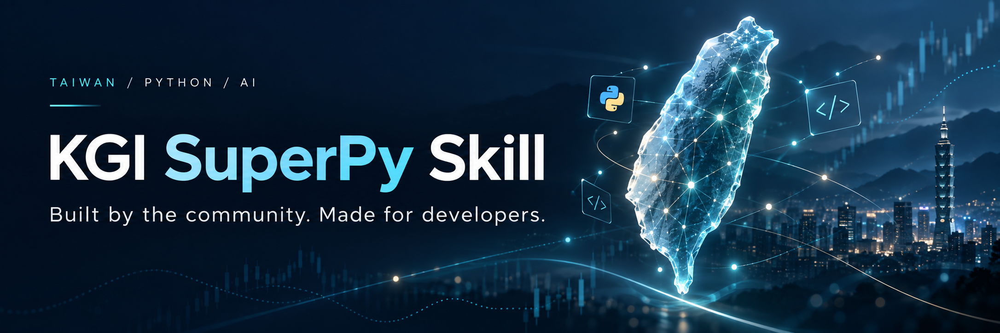

<p align="center">
  
</p>

<h1 align="center">把 SuperPy 實戰經驗，裝進你的 AI。</h1>

<p align="center">
  你的想法，值得一個懂 SuperPy 的開發夥伴。<br>
  從 API 串接、交易流程到操作介面，<br>
  <strong>把實務知識帶進每一次協作，一起做出屬於你的交易工具。</strong>
</p>

<p align="center">
  <a href="LICENSE"></a>
  
  
</p>

<p align="center">
  <a href="#quick-start"></a>
</p>

<p align="center">
  <a href="https://github.com/pypysuper-og/kgi-superpy-tw/releases/latest">下載 Skill</a> ·
  <a href="#in-practice">看看實務底氣</a> ·
  <a href="CONTRIBUTING.md">一起貢獻</a>
</p>

---

## 你的策略。你的介面。你的交易工具。

你知道自己想看什麼、怎麼操作、什麼時候需要提醒。**SuperPy Skill 為你的 AI 開發助手補上 API 知識與應用經驗，陪你把這些想法逐步做成工具。**

- **一眼掌握重點的行情看板** — 把關注商品、價格與狀態，整理成自己習慣的工作畫面。
- **符合自己規則的網格工作台** — 從參數設定、委託追蹤到異常處理，把策略想法轉成開發需求。
- **看得懂、用得順的部位監控** — 用泡泡或列表掌握部位，清楚呈現出場條件與監控狀態。

第一次動手、有程式想改善，或正在排查一個難解的問題，都能從手上的需求開始。

## 給 AI 知識，也給它實務眼光。

<table>
  <tr>
    <td width="50%" valign="top">
      <h3>接對 API，掌握市場差異</h3>
      <p>整理市場別的串接知識，讓 AI 從帳戶、行情到委託，依你的需求查找有依據的做法。</p>
      <p><strong>從一開始，就有脈絡可循。</strong></p>
    </td>
    <td width="50%" valign="top">
      <h3>看懂流程，接起功能前後</h3>
      <p>把狀態機、模組分工與互動關係連起來，協助 AI 思考成交晚到、斷線恢復與監控延續。</p>
      <p><strong>細節有去處，問題有追查方向。</strong></p>
    </td>
  </tr>
  <tr>
    <td width="50%" valign="top">
      <h3>設計介面，貼近實際操作</h3>
      <p>從網格與泡泡介面的演進，帶入資訊分層、操作回饋與監控視圖的設計思路。</p>
      <p><strong>畫面有重點，操作有回應。</strong></p>
    </td>
    <td width="50%" valign="top">
      <h3>關鍵時刻，多一份工程判斷</h3>
      <p>提醒 AI 回頭看功能目的、檢查假設，並找出值得驗證的下一步。你的策略與取捨，仍由你作主。</p>
      <p><strong>像有位實務夥伴，陪你多想一步。</strong></p>
    </td>
  </tr>
</table>

<a id="coverage"></a>

<p align="center">
  <strong>四大市場的 API 開發指引</strong><br>
  台股 · 美股複委託 · 國內期貨／選擇權 · 海外期貨／選擇權
</p>

<a id="in-practice"></a>

## 實戰的份量，藏在這些細節裡。

來自台美股示範程式的開發、除錯、測試與諮詢經驗，整理成 **三個完整案例**。每個案例都有情境、處理思路與可執行的離線範例，讓 AI 有具體經驗可以參考：

- [**單號還沒回來，程式該怎麼接著做？**](references/cases/us-delayed-identity.md)
- [**撤單送出了，為什麼成交又來了？**](references/cases/oco-cancel-late-fill.md)
- [**資料還沒齊，已發生的成交怎麼辦？**](references/cases/observe-before-eligibility.md)

這些案例使用合成資料重現關鍵情境；實務案例目前以台美股為主。

> **把一次次解過的問題，變成下一次開發的起點。**

<a id="quick-start"></a>

## 現在，帶著你的想法開始。

### 1. 幫你的 AI 加上 SuperPy Skill

使用支援 Skill 的 AI 開發助手，可以先把這段話交給它：

```text
請從 https://github.com/pypysuper-og/kgi-superpy-tw
安裝 kgi-superpy-tw skill。
```

也可以從 [GitHub Releases 下載](https://github.com/pypysuper-og/kgi-superpy-tw/releases/latest)，依使用工具的 Skill 安裝方式加入。

<a id="try-it"></a>

### 2. 交給它第一個任務

```text
請使用 $kgi-superpy-tw，幫我做一個台股行情觀察看板。
我想看到關注商品的最新價格、漲跌與連線狀態。
先釐清畫面和使用方式，再用假資料把操作流程跑通。
```

把範例換成你自己的需求。從一個小工具開始，也可以從你現有程式最想改善的地方開始。

<p align="center">
  <strong>下一個想做的工具，就從這次對話開始。</strong><br><br>
  <a href="https://github.com/pypysuper-og/kgi-superpy-tw/releases/latest"><strong>下載 SuperPy Skill →</strong></a>
</p>

---

本專案是社群維護的凱基（KGI）SuperPy API 開發 Skill，非官方產品。SuperPy SDK、API 開通資格與券商服務依官方提供；實際程式仍需按使用環境驗證。

<a id="references"></a>

[給 AI 的使用指引](SKILL.md) · [版本說明與下載](https://github.com/pypysuper-og/kgi-superpy-tw/releases) · [回報問題](https://github.com/pypysuper-og/kgi-superpy-tw/issues) · [貢獻指南](CONTRIBUTING.md) · [MIT 授權](LICENSE)
