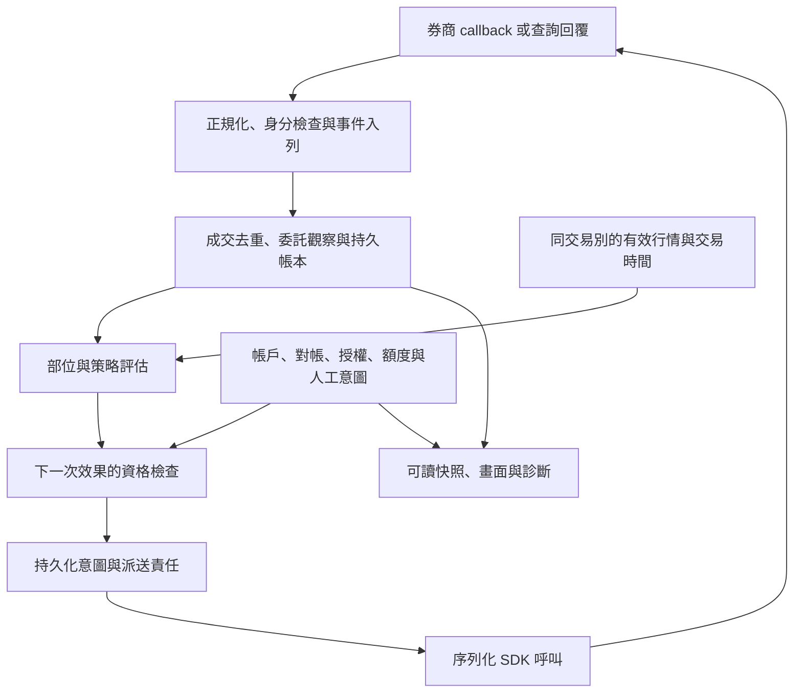

# 狀態機結構、模組對應與互動

適用於 SuperPy 交易工具的架構設計、狀態追查、恢復與驗收。先選一條使用流程，例如「外部成交被看見後持續監控出場」，再沿實際入口追到使用者能觀察的結果。狀態數量是導航資訊；改善以功能、正確性、效能與排錯能力判斷。

## 五個可獨立表達的面向

| 面向 | 表達什麼 | 範例 |
| --- | --- | --- |
| 交易事實／部位生命週期 | 已經確認發生的事件與餘量 | 已觀察、已入帳、持有、部分平倉、已平倉 |
| 自動效果資格 | 此刻可否執行下一次交易效果 | 待驗證、可自動出場、僅監控、人工處理 |
| 效果進度 | 某次要求是否已嘗試、受理或完成 | prepared、attempted、working、partial、cancel_pending、unknown、done |
| 資料與程序健康 | 依據是否可用、目前 owner 是否可靠 | fresh、stale、missing、disconnected、recovering、unresponsive |
| 操作者政策 | 使用者允許系統接下來做什麼 | 啟用、明確停止、自動恢復、人工接手 |

不需要為每欄建立一個新類別。現有 enum、旗標或衍生欄位足夠時沿用；重點是來源、寫入者與判斷語意清楚。例如 `position=open / eligibility=monitor_only / effect=none / health=reference_missing` 能表達「確實有部位，目前不會自動出場」。reference 缺漏不應把已確認成交改成不存在。

## 功能與責任模組

下列名稱是工作台常見的責任配置，並非本 skill 附帶可直接啟動的應用，也不要求所有專案使用相同檔名。

| 功能 | 常見實作角色 | 唯一寫入責任／對外提供 |
| --- | --- | --- |
| HTTP／桌面與命令 | Server、DesktopBridge、Service | 收請求、分配操作識別、發布進度；不從 UI 判定成交 |
| 業務事件 owner | Core、Engine、ApplicationService | 序列化事件、狀態轉移與帳本更新，決定下一步工作 |
| 券商適配 | SuperPyBroker、SDKSession | 公開 SDK 呼叫、回報正規化、帳戶與會話身分；callback 複製資料後入列 |
| 行情與時間 | Market、Quote adapter、交易日曆 | 市場／交易別、來源時間、世代、成交／五檔分組與新鮮度 |
| 部位與計價 | Unit、PositionAccounting、Journal | 成交去重、餘量、成本、在途預留與持倉週期 |
| 委託與持久意圖 | Intent store、WorkingOrders | 送撤單前保存責任，連接原單、後續回報與未明效果 |
| 對帳與恢復 | Recovery、BrokerRuntime | 身分配對、差異範圍、恢復原先意圖、保留人工停止與剩餘額度 |
| 程序監督（需要時） | Supervisor、Engine child | 存活、世代替換、退出交握；不取代交易狀態 |
| 畫面與診斷 | Snapshot、表格／泡泡、關聯 log | 投影已確認狀態、資料品質與下一步；不形成第二份可寫交易真相 |

單一 owner 的含義是每個可變資源有清楚的修改責任。SQLite 業務 owner 與序列化 SDK I/O 可以是不同執行邊界；多商品 async queue 也可能共用提交區段。不要由「有 async」推論所有商品完全不互卡。

## 觀察到效果的協作



每次交接記下：事件來源、目前／下一狀態、誰寫入、guard 的直接證據、持久化位置、外部效果、讀取者與可觀察結果。對簡單流程，一張短表就夠；有分支、跨 owner 或時序疑問才畫圖。

## 四種容易混淆的完成訊號

| 訊號 | 可以確認 | 還不能確認 |
| --- | --- | --- |
| HTTP 回傳 command id | 命令已被接收／入列 | SDK 已呼叫或券商受理 |
| command done | 該應用方法完成 | 委託成交、撤單終態或程序安全退出 |
| SDK 方法 returned | 同步呼叫返回 | 受理、最後累計成交或回報完整 |
| 券商終態＋完整對齊的成交 | 該原單的確認結果與量價 | 下一筆替換單已完成，或別的資料來源一定更新 |

命令在 SQLite 提交後、發布結果前失敗，要分開兩個觀察面：提交成功可以是帳本已確認的事實；呼叫端卻尚未收到可確認結果。對呼叫端可標為結果未明，而不是推成未執行；先以原操作識別及持久狀態查核後定案。仍在 queue 尚未開始的命令才是 `not_executed`。UI 超時也不能使已提交的事實消失或授權重送。

## 隱性狀態也有責任

- 數量：累計成交、已平量、未成交餘量、已預留出場量；以守恆與上限約束，不只看 status 字串。
- 身分：帳戶、交易日、原單、execution ID、會話／程序 generation；舊回呼與新 owner 不混用。
- 時間：行情來源／接收時間、有效期、退避預算、操作預覽期限；晚收到不等於業務狀態較新。
- 資源：queue、資料鎖、SDK 執行中、退出收據；HTTP 活著不代表交易 owner 能推進。
- 顯示：快取、輪詢錯誤、busy、dialog、草稿 revision；快取重畫不能清除已知失聯。

原生 SDK 呼叫逾時後仍可能晚到。舊會話一旦無法確認控制權，晚到的成功標記不能自行恢復其交易能力；依既有恢復設計建立可確認的新 owner／世代。這是適用於此時序風險的做法，不要求簡單查詢腳本先建監督程序。

## 恢復與局部隔離

```text
斷線 → 有限退避 → 同帳戶恢復 → callback／訂閱恢復
     → 委託、成交與庫存核對 → 新鮮資料 → 恢復原先允許的監控
```

恢復遵守既有使用協議。已授權自動續接時，對已核對範圍接回原監控，不重問同一授權；保留明確停止、人工接手與剩餘額度。需要人工決定的配對則停在該決定點。

能唯一定位且可隔離的商品衝突，只阻擋該範圍依賴的效果；未知帳號、共享資源或無法定位的差異仍影響其真正依賴。保留預留量與在途單責任，不能只拿掉全域旗標就宣布隔離完成。

低量股票暫無成交，處理的是資料有效性；連線存活要另有證據。恢復後要驗證下一次策略評估、送出要求、回報與帳本延續，不能只斷言登入成功。參見 [恢復契約](trading-uiux.md) 與 [測試分層](testing-and-replay.md)。
