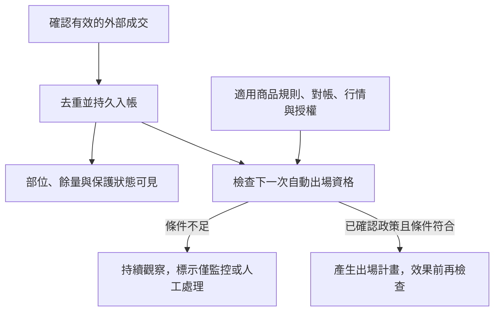

# 案例：參考資料缺漏，成交仍要入帳並可見

## 主用途與歷史教訓

工具的主要工作是監控指定帳戶由其他平台產生的成交，並依條件處理出場。諮詢檢視曾發現：reference 驗證放在登入或讀回報之前，資料缺漏會連觀察都被阻擋；另有 `PENDING / MANAGED` 同時承擔部位納管及自動出場資格的語意。

本案例提出可採用的分離設計，並以新寫的合成模型驗證。它不聲稱原諮詢程式已完成修復，具體納管範圍及後到 reference 是否可自動恢復仍由當下需求決定。

## 事件時間線

| 時點 | 事件 | 必須保留／限制 |
| --- | --- | --- |
| 1 | 已確認帳戶、交易日、交易類別的外部成交 1,000 股 | 保存 execution、量價及來源，部位可見 |
| 2 | reference 服務不可用 | 顯示資料缺漏與未受自動保護，阻擋新的自動出場 |
| 3 | 同 execution 再回報一次 | 部位仍是 1,000 股 |
| 4 | 程式重啟 | 已入帳部位保留，不能重複納帳或重播未知效果 |
| 5 | reference 恢復 | 依適用規則、已確認政策、對帳及新鮮行情重評估 |

## 三個獨立面向

| 面向 | 本案狀態 | 誰負責 |
| --- | --- | --- |
| 部位生命週期 | `booked_open`，已入帳 1,000 股 | 成交正規化與持久帳本 |
| 自動出場資格 | `monitor_only`／`manual_required` | 出場政策與資格檢查 |
| 外部效果進度 | `none`，尚無新要求 | intent／效果 owner |



資料健康是資格的輸入，不覆蓋已確認的交易事實。沒有自動出場資格的部位，也應出現在畫面、查詢及重啟後狀態中。其他平台的進場不由這個監控工具重新核准或否認。

## 對 guard 做第一性檢查

先確認 guard 想保護什麼：合法價格、當沖資格、當日規則，還是僅確認下載時間？官方 `Contract.update_date` 描述為更新時間，不能直接當作規則生效交易日。應以可核實的適用規則與來源判斷；證據仍不足時，阻擋依賴它的新效果，保留不依賴它的觀察與記帳。

適用於這個外部成交監控用途的拆分，不會自動改寫其他產品的進場政策。若需求其實是僅管理本程式開倉，先保留其納管邊界，再釐清擴充。

## 可執行檢查

```console
python -B -X utf8 examples/practical_cases.py --case reference-missing
python -B -X utf8 -m unittest discover -s examples -p test_practical_cases.py -v
```

示範預期：讀模型仍輸出 `booked_shares=1000`、`eligibility=monitor_only`，且 `exit_plan=null`。模型沒有 UI 或效果派送器，因此沒有以固定的「可見／未送單」旗標當作驗證。測試另涵蓋 SQLite 真正重開、重複回報、零部位、可賣量不足、reference 恢復仍缺授權／新行情，以及條件齊備後可以產生計畫。

模型的輸入已完成帳戶／交易日／交易類別驗證；它不解析原始 SDK 回報，沒有下單方法。`plan_exit` 只形成數量計畫，不是已送出委託。正式應用仍需驗證帳戶資料、原單與預留量、效果前檢查及回報延續。

官方依據：[成交查詢](https://superpy.kgieworld.com.tw/kgipythonapi/guide/tw/accountExecReport)、[商品資訊](https://superpy.kgieworld.com.tw/kgipythonapi/guide/tw/orderContract)。延伸：[狀態與模組](../application-state-models.md)、[人機協作](../human-agent-development.md)。
