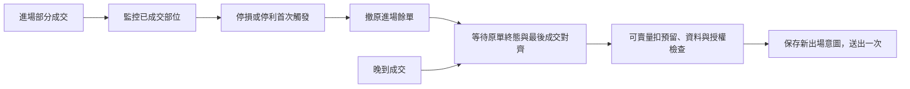

# 案例：撤單途中又成交，出場量如何算

## 目的與假設

本機成交後 OCO 要保護已成交部位，停損／停利觸發後先處理原進場餘單，再依最後可確認部位出場。此案由 OCO 範例的部分成交與撤單測試一般化；不是券商端預掛 OCO 的保證。

案例在內部一律以整數股表達：進場原單 2,000 股，先成交 1,000 股；已有適用此流程的出場授權，無其他出場預留。送入 SDK 時仍須依市場及整張／零股契約換回正確單位，不可直接套用示範內部股數。

## 時序與禁止的捷徑

| 時點 | 觀察 | 處理 |
| --- | --- | --- |
| 1 | 首筆成交 1,000 股 | 保留部位並開始監控 |
| 2 | 新鮮行情觸發停損 | 固定首次觸發，保存撤餘單意圖 |
| 3 | cancel 方法返回 | 仍追蹤原單，不宣稱撤單完成 |
| 4 | 晚到成交再增加 500 股 | 部位成為 1,500 股，按 execution 去重 |
| 5 | 原單取消終態，累計成交 1,500 股 | 核對成交明細／累計水位一致 |
| 6 | 可賣量、預留、行情與授權均符合 | 只嘗試一筆 1,500 股出場 |

終態報告若先於最後成交明細抵達，保留等待／查核；不能憑兩個欄位碰巧同時出現就假定所有來源原子更新。方法逾時、未知送單或原單身分不明時先查核，不重播撤單或出場。

## 協作狀態與責任



| 資料／工作 | 責任模組 | 互動 |
| --- | --- | --- |
| entry_filled、exit_filled、adjustment | Unit／持倉帳本 | 剩餘歸屬量供監控與出場共用 |
| trigger、cancel_requested | Engine／策略 owner | 固定本次處理意圖，不因每個 tick 重複觸發 |
| 原單狀態與累計水位 | Broker adapter／OrderView | 對齊遲到成交與取消結果 |
| 可賣量與其他在途賣單預留 | Account 查詢／庫存分配 | 出場前重查，避免重複分配 |
| intent 與 outcome | 持久化 Store | 未明結果跨重啟保留，不自動重播 |
| 「取消餘單」與「部位仍持有」 | UI 投影 | 避免把整個 unit 顯示成已取消無曝險 |

可平量不能只從第一筆成交或下單原量計算；依已確認的成交、已平量、在途預留與策略歸屬得到本次允許出場量。原單取消並不代表持倉歸零。

## 可執行檢查

```console
python -B -X utf8 examples/practical_cases.py --case cancel-late-fill
python -B -X utf8 -m unittest discover -s examples -p test_practical_cases.py -v
```

示範預期：終態前 `exit_before_terminal=null`，最後 `exit_shares=1500`，`cancel_calls=1`、`exit_calls=1`。`try_exit` 的可賣量、預留量、授權及行情判斷全部必填；`entry_terminal` 接受原進場的已確認終態，包含取消或全成交。全成交進場觸價時不記撤單要求。

測試涵蓋未觸發不出場、剛好足量仍能繼續、重複觸發、重複成交、終態先到、可賣量扣預留不足、缺授權及過期行情。正向案例同時確認資料補齊後能繼續出場，避免以永遠不交易換取測試通過。

## 實接與恢復限制

示範 `CancelLateFill` 是記憶體內的正規化數量／時序模型，沒有真的送單或持久化出場意圖；實際應用必須在 SDK 效果前保存 intent，重啟後核對該意圖及原單。出場部分成交、拒單或未明時保留剩餘量，依已確認策略轉人工或安排下一步，不能從本例推成自動追單。

整張市價 IOC 與盤中零股限價 ROD 是原 OCO 案例的不同執行選擇，不能互相借行情或套用單位。參見 [OCO 參考](../web-oco-application.md)、[交易數量](../orders.md) 與 [官方撤單](https://superpy.kgieworld.com.tw/kgipythonapi/guide/tw/orderCancel)。
