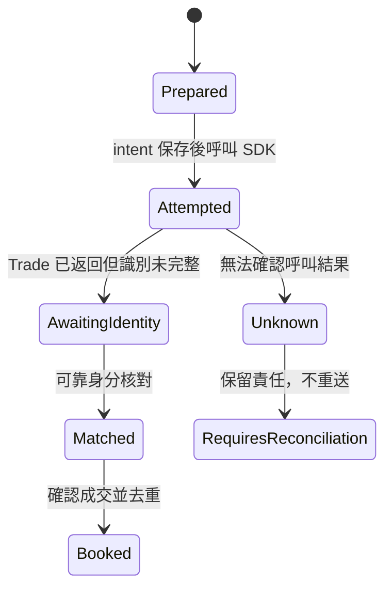

# 案例：美股同步返回空單號，稍後才有成交

## 目的與來源界線

使用者要讓已建立的複委託網格持續追蹤原委託與成交；不能因畫面等待逾時，再送一筆試探。此案取自複委託工作台的非同步識別缺口與隔離重現，依 SDK 2.1.2 的版本特定觀察一般化改寫。API 基線與完整診斷讀 [美股回報指南](../us-order-diagnostics.md)。

下方 Python 是新寫的合成模型，沒有執行歷史版工作台，也不代表某個原帳戶的 name 遺失原因已被證實。

## 事件時間線

| 時點 | 事件 | 可確認的事實 |
| --- | --- | --- |
| 1 | 本機保存唯一 intent，呼叫 create_order 一次 | 已跨入派送責任；未明結果須保留 |
| 2 | 返回 Trade，org_seqnum／order_id 空白 | 目前沒有完整識別，不能推成未送出 |
| 3 | UI 等待逾時 | 只代表 UI 未取得完成結果 |
| 4 | 稍後原 Trade 補上識別，callback／報表有相符事件 | 可在帳戶、世代及委託身分一致時建立關聯 |
| 5 | 確認一筆 4 股成交，之後同筆又出現 | 第一次入帳 4 股，重複事件不再加量 |

## 狀態與模組



| 責任 | 應用模組 | 本案可執行模型 |
| --- | --- | --- |
| 保留原 Trade 與目前會話 | Broker adapter | `DelayedIdentity.trade`、`MutableTrade` |
| 保存 intent、成交身分與量價 | Store／Ledger | `Journal.prepare`、`Journal.book` |
| 帳戶、generation、商品與原單配對 | 回報正規化／owner loop | `DelayedIdentity.observe` |
| 呈現等待、未明與查核結果 | command／snapshot／UI | 模型輸出的次數及已入帳量 |

## 錯誤模式與處理

立即把兩個空識別複製到本地、隨後丟掉可變 Trade，會失去原要求與後到識別的連結。只記 callback 卻沒有消費流程，也可能讓券商已成交、本地仍顯示零。

保留返回物件及可靠請求關聯；callback、SDK 快取與完整報表分開記來源、時間及識別。回報須驗證帳戶、交易日／世代、商品、方向、量價與既有關聯。不能只按同商品、同價格與時間接近認領，也不能假設某個來源永遠最新。

同 execution 身分內容完全相同時去重；同鍵量價矛盾時保留原確認值並標示衝突，不能當作新增成交或默默改成本。識別仍不明就保留查核責任；拒單重送是另一個需要確認零成交與新意圖的流程。

## 可執行檢查

從 skill 根目錄執行：

```console
python -B -X utf8 examples/practical_cases.py --case delayed-identity
python -B -X utf8 -m unittest discover -s examples -p test_practical_cases.py -v
```

示範預期：`create_calls=1`、`booked_shares=4`。測試另驗證回傳物件與回報皆為空識別也不能配對、錯帳戶、舊世代、錯原單、重複回報、量價衝突，以及未知 intent 在 SQLite 真正 close/reopen 後不重播 create。

## 證據與未覆蓋邊界

這是正規化事件與本機 SQLite 的離線證據。示範採一筆固定委託，只列出最小配對條件；真實 adapter 還需核對市場、交易別、原單數量與日期等契約。未知分支只驗證不重送，未建模未知結果經可靠報表恢復配對的正向流程。它未驗證原始 callback 格式、CA、券商實際受理、撮合或跨日原單重接，也不會從重啟自動恢復已遺失的記憶體 Trade 關聯。模型不包含 SDK，這是程式結構的界線，並非連線測試結果。

官方接點：[複委託 API](https://superpy.kgieworld.com.tw/kgipythonapi/guide/us/)。精確方法及參數以 [美股市場參考](../us-stocks.md) 和適用版本手冊為準。
