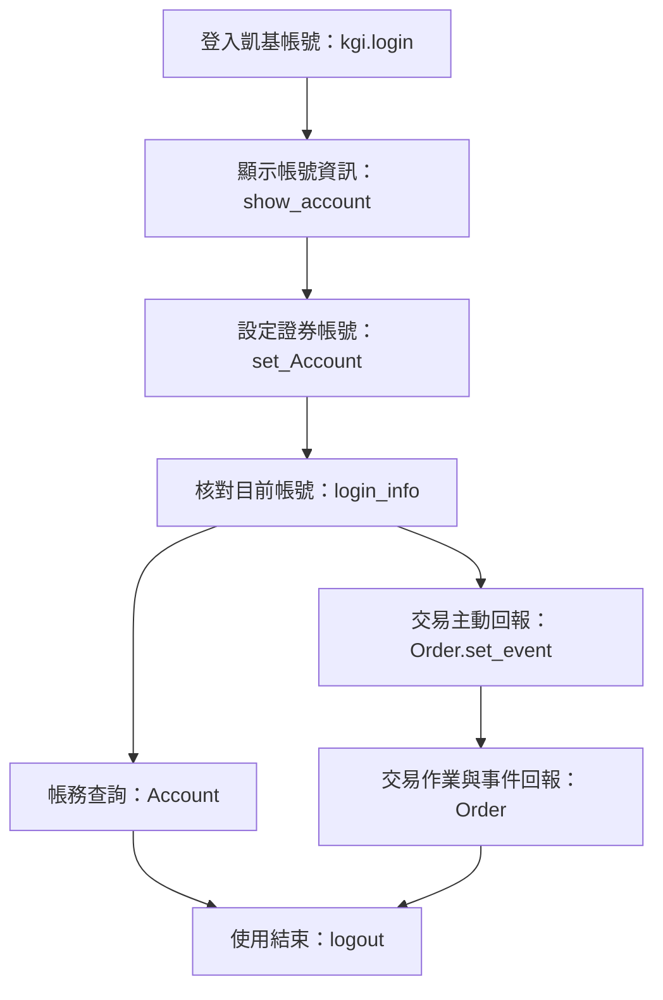

# Session and environment API

Source: v1.37, TOC 9–26; see [manual baseline](manual-baseline.md) for version conflicts.

<a id="tw-workflow"></a>

## 台股交易與帳務查詢流程

適用於台股作業前置、API 使用流程及參考筆記。官方功能頁於 2026-10-12 核對；以下區分 SDK 文件化介面與應用端的恢復責任。



| 功能 | 介面 | 作用與官方來源 |
| --- | --- | --- |
| 登入凱基帳號 | `kgi.login(person_id, person_pwd, simulation=True)` | 建立 API 工作階段；`True` 是測試環境、`False` 是正式環境，預設為 `True`。正式登入包含 CA 驗證與初始化。[登入說明](https://superpy.kgieworld.com.tw/kgipythonapi/guide/tw/inAccount) |
| 顯示帳號資訊 | `api.show_account()` | 查閱目前身分下的帳戶清單，欄位包含 `account`、`account_flag`、`broker_id`。台股使用類型為「證券」且身分符合目標的帳戶。[帳戶清單](https://superpy.kgieworld.com.tw/kgipythonapi/guide/tw/showAccount) |
| 設定交易帳號 | `api.set_Account(account)` | 指定證券帳號並啟用 `Order`、`Account`。官網範例包含委託／成交補檔與完成訊息。[設定說明](https://superpy.kgieworld.com.tw/kgipythonapi/guide/tw/setTransaction) |
| 顯示已登入帳號 | `api.login_info()` | 查閱目前帳號資訊，可核對「證券」項目下的帳號與券商代碼；不代替登入及初始化結果。[目前帳號](https://superpy.kgieworld.com.tw/kgipythonapi/guide/tw/showInAccount) |
| 交易主動回報 | `api.Order.set_event(handler)` | 在 `Order` 啟用後註冊單一 `event` 參數的回呼，接收新單、改價、改量、刪單及成交事件；交易操作前完成註冊。[交易回呼](https://superpy.kgieworld.com.tw/kgipythonapi/guide/tw/orderSetEvent) |
| 斷線重新登入 | `api.set_disconnect_cb(re_login)` | 預先註冊無參數的斷線回呼。官網範例在回呼內呼叫既有物件的 `api.login()`。[重登說明](https://superpy.kgieworld.com.tw/kgipythonapi/guide/tw/reLogin) |
| 登出 | `api.logout()` | 結束工作階段並重置目前載入設定。之後可使用 `api.login()` 再登入；未完成委託的刪單需另行處理及確認。[登出說明](https://superpy.kgieworld.com.tw/kgipythonapi/guide/tw/logout) |

`show_account()` 與 `login_info()` 用於資訊查詢及核對。帳號設定與回呼註冊屬於初始化或恢復作業，通常不必每次查帳或送出委託都重做。多帳戶時，依市場與目標帳號識別，不預設採用清單第一項。

**帳務查詢與交易回報：** 證券帳號設定後，帳務查詢可獨立使用 `api.Account`，不以交易 callback 為必要前提。核對委託、成交與庫存的介面包括 [OrderReport](https://superpy.kgieworld.com.tw/kgipythonapi/guide/tw/accountOrderReport)、[ExecReport](https://superpy.kgieworld.com.tw/kgipythonapi/guide/tw/accountExecReport)、[InventorySum](https://superpy.kgieworld.com.tw/kgipythonapi/guide/tw/accountInventorySum)；參數與回傳內容見 [帳務](accounts.md)。

**事件語意：** `event.task` 表示事件種類，`event.status` 表示該次操作狀態。`NewOrder + Success` 表示新單操作成功，成交資訊由 `Task.Deal` 等成交回報提供；操作成功與成交分別判讀。詳見 [Event 物件](https://superpy.kgieworld.com.tw/kgipythonapi/guide/tw/eventObject) 與 [交易回呼](orders.md#event-callback)。股價、委買委賣等行情使用另一組 [行情 callback 與訂閱](quotes.md)。

**工作階段恢復：** 斷線回呼是在 API 物件建立後預先設定的例外處理，不是正常啟動流程最後執行的一步。重新登入後，帳號、交易 callback、委託／成交及庫存核對由應用程式處理；有使用行情或自動監控時，其訂閱、資料更新及監控意圖也需恢復。結果不明的委託先查證，不重複送單。官網重登範例不建立「全部流程已自動恢復」的保證，詳細恢復條件見 [交易應用工作流程](trading-uiux.md)。

**結束作業：** 正常結束時先停用應用端自動操作及自動重登，再登出。登出、斷線恢復與刪單各有不同作用，流程圖應依發生時機呈現。

## Environment contract

- Package: `kgisuperpy`
- Install command: `python -m pip install kgisuperpy`
- Documented Python: 64-bit Python 3.9 through 3.14 in the Taiwan/futures requirements. The manual attributes 3.14 support to SDK V2.1.2; the US table still says 3.13 but its later version check says 3.14. Verify the installed SDK/platform instead of treating this as a runtime test
- Documented Windows: 64-bit Windows 10 or later
- Documented Linux: Red Hat 7 or Ubuntu 20 or later, with KGI `libCGCrypt.so` and certificate utility installed
- Production use requires a KGI account, API eligibility, accepted service documents, and an active CA certificate.
- Taiwan securities simulation: business days 08:30 through 05:00 the next day. Futures simulation: business days 10:00–22:00. These are test-service windows, not production exchange hours.
- The testing terms specify Taiwan-only IP during 08:00–20:00; they do not establish access permissions outside that interval.
- US stocks: the manual explicitly says simulation is not offered. Generic testing paragraphs that follow do not override that statement. Never switch to production merely to make a test work.
- Testing instructions say to separate stock, futures and sub-brokerage accounts and keep order-test intervals greater than one second. This is a documented test condition, not an established universal production rate limit.
- Sub-brokerage API eligibility requires manual application through the sales representative; do not assume securities API activation enables every market.
- The official terms conditionally say that users with functional-testing needs can apply to a relevant KGI unit for a test account. This is not stated as a universal requirement for simulation use.
- The public documentation does not name that unit, provide a test-account application method, or state whether production credentials can be used in simulation. Keep these points unknown rather than inferring them.

## CA setup details

Windows: use the provider certificate component, apply for the certificate, then its certificate environment checker. Linux: install `libCGCrypt.so` with executable permissions in the distribution-appropriate library directory and run the provider `KGI_CGCrypt genDat` utility; the manual identifies `CGSetCertConfig [ 0 ]` as certificate installation success. Certificate installation success is separate from API login success. Renewal instructions remove the old certificate before reinstalling; do not delete a working certificate without explicit scope and a recoverable replacement.

## Account activation and processing delay

Account activation may be followed by platform account-information processing (帳戶資訊過檔). A reported case required waiting until the next day. Completing the application or local certificate setup does not imply immediate platform account readiness.

Source and scope: a community-reported case dated 2026-09-05 attributed the preceding day's login failure to account processing and reported a successful next-day login/CA sequence. Its private login artifacts are not distributed here, so readers cannot independently verify that case from this repository. It is not a waiting-period statement verified in the public guide.

The exact batch cutoff, whether “one day” means a calendar or business day, and a guaranteed 24-hour completion time are unspecified. Do not invent those details or generalize this case into a diagnosis for every login failure. Readiness is still confirmed using the official success sequence below.

## Login

```python
import kgisuperpy as kgi

api = kgi.login(person_id, person_pwd, simulation=True)
```

| Parameter | Type | Meaning |
| --- | --- | --- |
| `person_id` | `str` | User identity number |
| `person_pwd` | `str` | Account password |
| `simulation` | `bool` | `True` for simulation; `False` for production; default `True` |

Both environments use the documented `person_id` and `person_pwd` login parameters; simulation is not documented as anonymous or login-free.

## Official production and CA login confirmation

For production, call only the documented login entry point:

```python
api = kgi.login(person_id, person_pwd, simulation=False)
```

The official successful-login example shows this sequence:

1. `OnConnected()`
2. `OnLogonResponse()`
3. `IsSucceed:True ReplyString:登入成功`
4. Automatic account-list output
5. `CA 驗證通過，帳務與下單功能已初始化。`
6. `API 加載完成，歡迎使用。`

Use that documented sequence as the CA-login success evidence. The documentation does not define an `is_logged_in()` method or other Boolean login-status API. Do not substitute `repr(api)`, `print(api)`, `api._ObjOrder.FIsLogon`, or any other private/internal member as an application-level success check.

After the documented success sequence, the public account query may be used to verify that the documented account surface is usable:

```python
accounts = api.show_account()
print(accounts)
```

`show_account()` is documented as an account query, not as a CA-status method. Do not describe it as an official Boolean login checker.

The official login page states that account login and CA activation provide permission for quotes, historical data, and orders. It does not define quote availability after CA login fails. Do not rely on, promise, or encode quote-without-CA behavior as an official contract; any such runtime observation is version-specific diagnostic evidence only.

## Market selection

| Market | Method | Initialized surfaces |
| --- | --- | --- |
| Taiwan stocks | `api.set_Account(account)` | Order, Account |
| US sub-brokerage | `api.set_SubAccount(account)` | SubOrder, SubAccount |
| Domestic futures/options | `api.set_FutAccount(account)` | FutOrder, FutAccount |
| Overseas futures/options | `api.set_OvfutAccount(account)` | OvfutOrder, OvfutAccount |

Select the account using the `account_flag` label and exact user-selected account identity; do not hardcode a first list element. Domestic and overseas futures selection remain separate even if a displayed account identity is shared. Selection examples show report backfill and completion; preserve that context before interpreting order tracking after reconnect.

## Account and lifecycle methods

```python
accounts = api.show_account()
api.set_Account(account)
selected = api.login_info()
api.logout()
```

- `show_account()` returns a list of dictionaries with `account`, `account_flag`, and `broker_id`.
- `set_Account(account: str)` selects a securities account and initializes `Order` and `Account`.
- `login_info()` returns selected login data keyed by account class such as `證券`, `期貨`, and `複委託`.
- `logout()` ends the session.

## Disconnect callback

For a local Web application, read [the application pattern](web-oco-application.md) for actor-owned login, redacted progress output, inventory confirmation, and logout followed by server shutdown. SDK `api.logout()` alone does not stop a Web server; the linked design is application behavior, not an additional KGI API.

```python
def re_login():
    api.login()

api.set_disconnect_cb(re_login)
```

The callback receives no documented argument. The official example calls `api.login()` on the existing instance. This example only restores the trading login; it does not prove that quote subscriptions, callbacks, polling or strategy evaluation have resumed. For a continuously running application, follow [whole-workflow recovery](trading-uiux.md): restore the exact account and required data flows, reconcile orders/fills and holdings, then resume previously enabled monitoring under the existing product/user authorization. A previously agreed automatic resume should not require another confirmation when the checks agree. Preserve manual stops and remaining limits; never replay unknown orders. Apply capped exponential backoff and an explicit stop on logout/shutdown; a user-requested persistent mode may retry without an attempt limit. Report login, data readiness and monitoring recovery separately.

## Official pages

- [Prerequisites](https://superpy.kgieworld.com.tw/kgipythonapi/guide/tw/prefix)
- [Service terms and runtime requirements](https://superpy.kgieworld.com.tw/kgipythonapi/guide/tw/terms)
- [Login](https://superpy.kgieworld.com.tw/kgipythonapi/guide/tw/inAccount)
- [Show accounts](https://superpy.kgieworld.com.tw/kgipythonapi/guide/tw/showAccount)
- [Select securities account](https://superpy.kgieworld.com.tw/kgipythonapi/guide/tw/setTransaction)
- [Show selected accounts](https://superpy.kgieworld.com.tw/kgipythonapi/guide/tw/showInAccount)
- [Logout](https://superpy.kgieworld.com.tw/kgipythonapi/guide/tw/logout)
- [Reconnect login](https://superpy.kgieworld.com.tw/kgipythonapi/guide/tw/reLogin)
